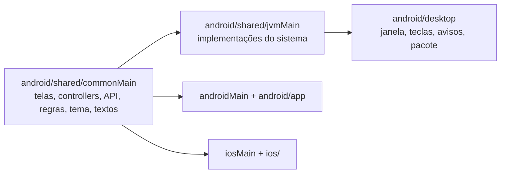

# Zaplaud desktop (Linux e macOS)

O Zaplaud desktop é o mesmo app do celular rodando numa janela. Telas, regras, API, tema e textos vêm do módulo
Kotlin Multiplatform `android/shared` (`commonMain`); o desktop só acrescenta o que depende do sistema. Por isso
qualquer mudança feita no Zaplaud do celular aparece no desktop sem retrabalho, e os dois continuam visualmente iguais.

Histórico da decisão e números: planos [063](../plans/063-zaplaud-desktop-alvo-jvm.md) a
[067](../plans/067-zaplaud-desktop-medir-e-decidir-rust.md), medição das pilhas em
[063-medicao-pilhas-desktop.md](../plans/063-medicao-pilhas-desktop.md) e do app real em
[067-resultado.md](../plans/067-resultado.md). O caminho para um cliente Rust está no
[plano 074](../plans/074-zaplaud-cliente-rust-slint.md).

## Como compilar, testar e instalar

Requer JDK 17 ou superior. Comandos a partir de `android/`:

| Para quê | Comando |
|---|---|
| Abrir em modo de desenvolvimento | `./gradlew :desktop:run` |
| Testes JVM (store, anexos, avatares, duas colunas) | `./gradlew :shared:jvmTest` |
| Distribuição com runtime próprio | `./gradlew :desktop:createReleaseDistributable` → `desktop/build/compose/binaries/main-release/app/Zaplaud/` |
| Pacotes `.deb` / `.rpm` | `./gradlew :desktop:packageReleaseDeb :desktop:packageReleaseRpm` (exigem `dpkg-deb` / `rpmbuild`) |
| `.dmg` (só num Mac) | `./gradlew :desktop:packageReleaseDmg` |
| Instalar no Arch (sem `sudo`) | `bash scripts/desktop-install-linux.sh` na raiz do repo → `~/.local/opt/zaplaud` + item no menu |

Os testes de duas colunas (`TwoPaneWideUiTest`, `TwoPaneNarrowUiTest`) sobem o servidor de teste
`scripts/android-smoke.ts` com `node`; precisam de `npm ci` na raiz e de uma tela (`DISPLAY`). Sem `node`, são
ignorados. No CI (`.github/workflows/android.yml`, job `verificar`) rodam com `xvfb-run`.

## Arquitetura

### O que é específico do desktop (`android/shared/src/jvmMain`)

| Peça | Arquivo | Comportamento |
|---|---|---|
| Rede | `data/HttpTransport.jvm.kt` | Cópia de `HttpTransport.android.kt` (Ktor + OkHttp, sem redirecionamento, SSE limitado). Mudou um, mude o outro. |
| Estado local | `data/LocalStateStore.jvm.kt` | Porta do store iOS: arquivos JSON com gravação atômica; configurações do aparelho em `java.util.prefs`. Mesmo formato do iOS. |
| Pastas | `data/DesktopDirs.kt` | Linux: `~/.local/share/zaplaud` e `~/.cache/zaplaud` (respeita `XDG_*`); macOS: `~/Library/Application Support/Zaplaud` e `~/Library/Caches/Zaplaud`. Permissão 700. |
| Cookie de sessão | `data/SessionCookieStore.jvm.kt` | Chaveiro do sistema (`java-keyring`: Secret Service / Keychain). Sem chaveiro, fica só na memória e o login é pedido a cada abertura. Nunca vai para arquivo. |
| Anexos | `data/Attachments.jvm.kt` | Seletor nativo (AWT `FileDialog`, vários arquivos); o arquivo é referenciado pelo caminho, não copiado. |
| Avatares | `data/AvatarCache.jvm.kt` | Mesmos limites do Android: PNG 60×60, 4 MiB em memória, 16 MiB em disco, validade de 24 h. |
| Teclas e plataforma | `UiPlatform.jvm.kt` | Esc fecha a conversa (`dispatchDesktopBack`), Ctrl/Cmd+F abre a busca (`dispatchDesktopSearch`), Enter envia e Shift+Enter quebra linha (`platformSendsOnEnter`). |

Propriedades de sistema usadas pelos testes: `zaplaud.dataDir`, `zaplaud.prefsNode` e `zaplaud.keyring=memory`
(definidas no `jvmTest`, que roda um processo por classe).

### Host (`android/desktop`)

- `Main.kt`: janela 1100×760, ícone, Esc e Ctrl/Cmd+F no `onKeyEvent` da janela. Ícone na bandeja pela biblioteca
  `dev.nucleusframework:composenativetray` (StatusNotifierItem via DBus, o que waybar e KDE mostram; a bandeja do AWT
  usa XEmbed e não aparece neles): clique traz a janela; menu com "Abrir o Zaplaud" e "Fechar o Zaplaud". Fechar a
  janela continua encerrando o app. No Linux, `main()` troca o `WM_CLASS` do XToolkit para `zaplaud` (reflexão, com
  `--add-opens=java.desktop/sun.awt.X11` nas flags do pacote): no Xwayland o `app_id` vem do `WM_CLASS`, e assim
  docks (wf-dock) acham `zaplaud.desktop` (`StartupWMClass=zaplaud`) e o ícone.
- `DesktopAlerts.kt`: avisos de aprovação, pergunta e fim de turno **enquanto o app está aberto e a janela não está
  em foco**. Usa o mesmo laço do Android (`data/AlertWatcher.kt`, `watchAlerts`). Linux: `notify-send` com ação
  "Abrir", que traz a janela e abre a sessão. macOS: `osascript`, sem clique para abrir. Não roda com a janela
  fechada (decisão do dono, 2026-11-09).
- `build.gradle.kts`: pacotes com `-XX:+UseSerialGC -Xmx256m`. ProGuard desligado (falha com 50 referências opcionais
  do OkHttp).

### Duas colunas em tela larga (todas as plataformas)

`ReadingScreen.kt` usa duas colunas a partir de 840 dp: lista de sessões fixa à esquerda (360 dp, sessão aberta
destacada, botão de chamar contato no pé), conversa à direita com largura máxima de 840 dp, e "Selecione uma
conversa" quando nada está aberto. Vale no desktop, no iPad e em tablet Android. Abaixo de 840 dp, a tela é a do
celular. Qualquer mudança na lista ou na conversa precisa ser conferida nas duas larguras.

## Consumo medido (2026-11-09, Xvfb com renderização por software)

| | Abrir | Memória parada (PSS) | CPU minimizado | Pacote |
|---|---:|---:|---:|---:|
| Zaplaud desktop (Compose) | 1.020 ms | 339 MiB | 0,10% | 192 MiB |

Só 91 MiB da memória são heap Java; o resto é runtime e desenho. Nenhuma flag da JVM reduziu 10% ou mais. O AppCDS
dinâmico corta a abertura para 524 ms, mas exige gerar um arquivo `.jsa` por versão e não foi integrado. Números
completos e método em [067-resultado.md](../plans/067-resultado.md).

## Limitações conhecidas

- Não testado: macOS, Wayland, Secret Service (GNOME Keyring/KWallet), servidor de notificação real, minimizar com
  gerenciador de janelas, leitor de tela.
- `.deb`/`.rpm` ainda não foram gerados numa máquina com as ferramentas; `.dmg` sem assinatura nem notarização.
- No macOS, clicar num aviso não abre a sessão (limite do `osascript`).
- Três cópias deliberadas a manter juntas: `HttpTransport.jvm.kt` ↔ Android; `LocalStateStore.jvm.kt` ↔ iOS; funções
  de data ↔ Android.
- `animationsEnabled()` ignora "reduzir animações" do GNOME/macOS.
