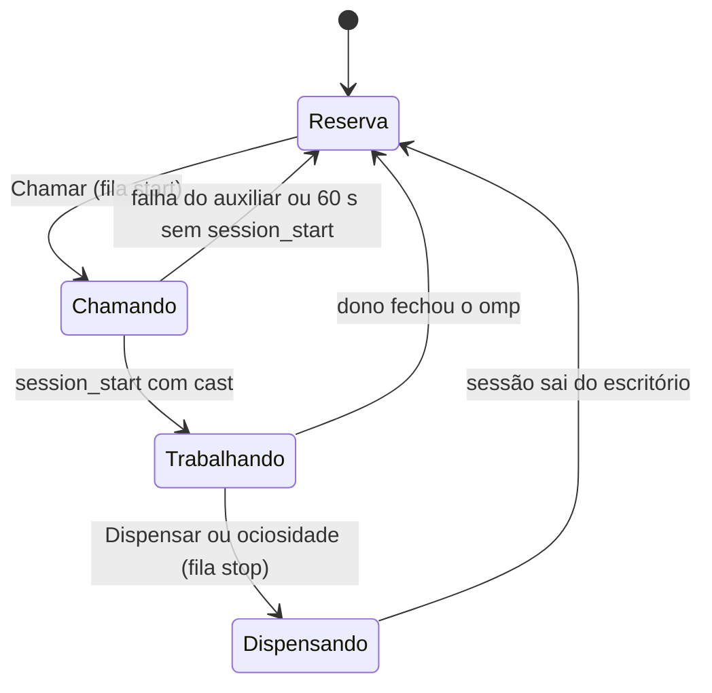

# Plan 032: Chamar e dispensar personagens do elenco (omp no host, via auxiliar e tmux)

> **Executor instructions**: Follow this plan step by step. Run every
> verification command and confirm the expected result before moving to the
> next step. If anything in the "STOP conditions" section occurs, stop and
> report — do not improvise. When done, update the status row for this plan
> in `plans/README.md` — unless a reviewer dispatched you and told you they
> maintain the index.
>
> **Drift check (run first)**: o plano 031 precisa estar mesclado no branch `rpg` (merge `2ff0e3d`). Depois:
> `git diff --stat 2ff0e3d..rpg -- server/model/cast.ts server/model/office.ts server/http/app.ts server/spawn/spawn.ts scripts/codex-bridge.ts shared/types.ts mod/habblaud-omp/habblaud.ts client/src/ui client/src/world/sim client/src/world/layout/core.ts`
> Se algum arquivo mudou depois do merge do 031, compare com "Estado atual confirmado"; divergência = STOP.

## Status e dependências

- **Priority**: P2.
- **Effort**: L.
- **Risk**: MED: o Habblaud passa a abrir e encerrar processos do omp no host.
- **Category**: direction.
- **Planned at**: commit `2ad0d99` + plano 031 (não implementado), 2026-10-28. Base de execução: branch `rpg`
  (`~/Desenvolvimento/habblaud-rpg`), merge `2ff0e3d` do 031.
- **Depends on**: 031 (elenco, `castFor`, `HABBLAUD_CAST` → `OmpEvent.cast`).
- **Linha de desenvolvimento**: o elenco (031) e este plano vivem só no branch `rpg`. Não levar a `producao` nem a
  `~/apps/habblaud`.

## Decisões do dono (2026-10-28)

1. A sessão chamada roda **no host**, aberta pelo **auxiliar do host** (o mesmo processo de `npm run codex:bridge`),
   dentro de uma sessão **tmux**. O servidor nunca abre o omp sozinho.
2. Ao chamar, **o dono escolhe na hora**: "Continuar" (retoma a última sessão do personagem naquela sala) ou "Nova".
3. A sessão termina pelo botão **Dispensar** e por **ociosidade**. Fechar o terminal continua funcionando como hoje.
4. O personagem carrega um **perfil**: modelo (`--model`) e instruções próprias (`--append-system-prompt`).
5. Do 031: personagem ocupado → a sessão nova sorteia; salas só organizam (não são segurança).
6. Membros fora de sessão ficam **no escritório, apagados, na área de descanso** (lounge do núcleo). Só na tela
   local: nunca no Habblaud World.

## Por que mudar

Com o 031 o personagem existe antes da sessão, mas quem abre e fecha a sessão ainda é o dono, no terminal. O
dono quer chamar um personagem pelo escritório (ele entra na sala e começa a trabalhar) e dispensá-lo (ele sai e
volta ao banco de reserva), sem montar o comando à mão.

## Estado atual confirmado

- Produção pessoal: `~/.config/containers/systemd/habblaud.container` roda a imagem `localhost/habblaud:producao`
  com `Network=host`, `HABBLAUD_IN_DOCKER=0`, `HABBLAUD_OMP_BIN=%h/.local/bin/omp` e
  `Volume=%h/Desenvolvimento:%h/Desenvolvimento:ro`. Um omp aberto **dentro** do contêiner não editaria os
  projetos: por isso o auxiliar no host (decisão 1). `~/.habblaud` é montado RW no mesmo caminho do host.
- Nenhum auxiliar roda hoje no host (`systemctl --user list-units` só mostra `habblaud.service` e
  `omp-tenant-painel.service`).
- Auxiliar: `scripts/codex-bridge.ts` já é o "auxiliar do host": rodadas de poll/ack para mensagens ao Codex,
  agentes novos (`spawnRound`, linhas ~306-343, `POST /api/host/spawn/poll` e `/ack`), arquivos e ditado. Cada
  rodada valida o pedido antes de rodar e nunca lança.
- Trava das rotas do auxiliar: `server/http/app.ts:687-706` — `POST`, `trusted(req)` e, fora do Docker, só
  loopback. Com `Network=host`, o auxiliar no host chega pelo loopback.
- Presença do auxiliar: `server/spawn/spawn.ts:33` `HOST_PRESENCE_MS = 10_000` (o servidor considera o auxiliar
  presente até 10 s depois da última rodada).
- Encerrar hoje: `PtyManager.stop` (`server/pty/manager.ts:250-263`) só encerra Claude Code (registro
  `<conta>/sessions/<pid>.json`). Nada encerra sessões do omp.
- Saída do escritório: sem batimento da extensão por 30 s a sessão do omp é dada como encerrada →
  `Office.closeMain` (`server/model/office.ts:562-585`): `offline`, sai depois de `OFFLINE_GRACE_MS` (20 s), e os
  subagentes saem junto.
- omp 18.12.6 (`/opt/omp-tenant/omp --help`): `--model`, `--append-system-prompt` ("Append text or file contents"),
  `-r/--resume <id|prefixo|caminho>`, mensagens posicionais (prompt inicial no modo interativo), `--max-time`
  (duração total, **não** ociosidade). `autoResume: false` em `~/.omp/agent/config.yml`.
- Contas do omp: agent dir por conta via `PI_CODING_AGENT_DIR` (`server/sources/omp/accounts.ts:1-61`).
- tmux 3.8 no host. Conferido: `tmux new-session -d -s <nome> -c <pasta> -e VAR=valor -- <prog> <args...>` roda
  o programa direto, sem shell: `$(...)`, `;` e espaços chegam literais no env e nos argumentos.

## Escopo

**Dentro:**

1. Perfil no membro do elenco: `model`, `instructions`, `idleMinutes`, `account`.
2. Fila de chamadas e dispensas no servidor (`server/cast/launcher.ts`), com rotas do navegador e do auxiliar.
3. Rodada nova no auxiliar (`castRound`) que abre e encerra sessões tmux `hb-<id>`.
4. "Continuar" usa a última sessão do membro naquela sala (gravada pelo servidor).
5. Ociosidade: o servidor manda dispensar quem ficou `idle` por `idleMinutes`.
6. Cliente: reserva no escritório (membros fora de sessão sentados apagados no lounge), "Chamar" (sala,
   Continuar/Nova, prompt opcional) pelo clique no personagem da reserva e pela tela "Elenco", e "Dispensar" na
   gaveta.
7. Unidade systemd de exemplo para o auxiliar no host (`deploy/podman/habblaud-bridge.service`).

**Fora (não fazer):**

- Tenants do `omp-tenant` (o omp de cada usuário roda noutro contêiner): precisa de plano próprio no repositório
  `omp-tenant`, como o 034. Neste plano, sem auxiliar presente o botão "Chamar" fica desabilitado com o motivo.
- Chamar advisor e subagentes: quem os cria é o omp; eles só vestem membros (031).
- Encerrar sessões que o Habblaud não abriu (omp aberto pelo dono num terminal): sem "Dispensar" nelas.
- Claude Code e Codex: o "Encerrar"/"Assumir" atuais continuam como estão.
- Mostrar o TUI do tmux dentro do navegador. O escritório já mostra o terminal pelo transcript e manda mensagens
  pela extensão; o TUI cru fica em `tmux attach -t hb-<id>`.
- Publicação (produção, unidade systemd ativada) é do operador.

## Contrato de destino

### Perfil (campos novos em `CastMember`, só `kind: 'main'`)

```ts
model?: string;          // passado em --model; 1-200 caracteres, sem espaço nem controle
instructions?: string;   // até 8000 caracteres; vira --append-system-prompt <arquivo>
idleMinutes?: number;    // inteiro 5-1440; ausente = 30; 0 = nunca dispensar por ociosidade
account?: string;        // id de conta do omp conhecida; ausente = a padrão
/** Última sessão por sala (pathKey → sessionId), gravada quando a sessão veste o membro. */
last?: Record<string, string>;
```

### Ciclo de um membro



"Chamando" e "Dispensando" ocupam o membro: o 031 já trata membro ocupado (sorteio), e o servidor recusa outra
chamada (409).

### Navegador → servidor (trava do editor do 031: `deps.terminal` + `trusted(req)`)

| Rota | Corpo | Resposta |
|---|---|---|
| `POST /api/cast/:id/start` | `{room, mode: 'resume' \| 'new', prompt?}` | 202 `{job}`; 409 ocupado/chamando; 422 sala não permitida, `resume` sem `last[room]`, membro não `main`; 503 auxiliar ausente |
| `POST /api/agents/:id/dismiss` | — | 202 `{job}`; 404 agente sem membro aberto pelo Habblaud |
| `GET /api/cast/jobs` | — | estado das filas (para o cliente mostrar "chamando…" e erros) |

`prompt` até `PROMPT_MAX` (8000). `room` é um `pathKey` de `rooms` do membro (ou qualquer pasta conhecida de
`recentFolders` se `rooms` estiver vazio).

### Servidor → auxiliar (trava de `/api/host/spawn/*`)

`POST /api/host/cast/poll` → `{jobs: CastJob[]}`; `POST /api/host/cast/ack` `{results: [{id, ok, error?}]}`.

```ts
type CastJob =
  | { id: string; op: 'start'; cast: string; folder: string; agentDir: string; model?: string;
      instructionsFile?: string; resume?: string; prompt?: string }
  | { id: string; op: 'stop'; cast: string };
```

- `instructionsFile`: o servidor grava `<dataDir>/cast/<id>.md` (mesmo caminho no host, volume RW) e manda o
  caminho; o auxiliar confere que está dentro de `<dataDir>/cast/`.
- Auxiliar, `start`: confere `cast` (`[a-z0-9-]{1,40}`), pasta absoluta que existe, `agentDir` com `sessions/`,
  binário do omp (`HABBLAUD_OMP_BIN` › PATH › `~/.bun/bin/omp`, mesma ordem de `ompBinFrom`), `tmux` no PATH e
  nenhuma sessão `hb-<cast>` já aberta. Roda:
  `tmux new-session -d -s hb-<cast> -c <folder> -e HABBLAUD_CAST=<cast> -e PI_CODING_AGENT_DIR=<agentDir> -- <omp> [--model <m>] [--append-system-prompt <arquivo>] [--resume <sid>] [<prompt>]`
  com `execFile` (nunca shell). Ack = o `tmux` saiu com 0.
- Auxiliar, `stop`: `tmux kill-session -t hb-<cast>` só se a sessão existir; inexistente = ok (já saiu).
- Sempre o servidor tmux padrão do usuário (`tmux attach -t hb-<id>` funciona do terminal do dono).

### Servidor

- `CastLauncher` (`server/cast/launcher.ts`): filas `start`/`stop` como `SpawnService` (prazos `QUEUED_TIMEOUT_MS`,
  `SENT_TIMEOUT_MS`, `KEEP_MS`), presença do auxiliar por `HOST_PRESENCE_MS`, e o conjunto `opened: Map<cast, at>`
  dos membros abertos pelo Habblaud (só eles têm "Dispensar").
- Chamando sem `session_start` do membro em 60 s: job falha, aviso, membro volta à reserva (a sessão tmux, se
  existir, recebe `stop`).
- Ao vestir o membro (031, `castFor`), gravar `last[pathKey(sala)] = sessionId`.
- Ociosidade no `tick` do servidor: agente com `cast` em `opened`, status `idle` há `idleMinutes` → `stop` e aviso
  `tr('💤 {0} foi dispensado por ociosidade em {1}', ...)`. `waiting` e `shell` não contam como ociosos.
- `/new` dentro do omp (mesmo processo) mantém o membro (031, `switchSession`).

### Reserva no escritório

- Snapshot: campo novo `OfficeSnapshot.reserve?: ReserveInfo[]` (`{cast, name, look, seed, parts?, state:
  'idle' | 'calling' | 'dismissing'}`), só membros `kind: 'main'` sem agente presente. **Fora de `agents`**: o
  uplink do World lê `office.agents()` (`server/world/uplink.ts:704`), não o snapshot, então a reserva nunca sai da
  máquina sem tocar em `shared/world/` nem `server/world/`. A linha do tempo (timelapse) também não grava `reserve`.
- Lugar: a área `core:lounge` (`LOUNGE_ID`, `client/src/world/layout/core.ts`), que existe nos dois prédios
  (`layoutLounge` no completo, `layoutBreakRoom` no compacto). Ordem dos lugares: `sofa` (3), `armchair` (2),
  `beanbag`. Membros a mais que lugares livres não aparecem no lounge (a tela "Elenco" lista todos).
- Os lugares da reserva ficam reservados no `SpotRegistry` (`client/src/world/sim/spots.ts`): agentes em pausa
  usam os outros spots do lounge e da copa.
- Visual: o personagem desenhado com opacidade 0,45, sentado, sem balão, sem animação de trabalho; nome no hover.
  `calling` mostra o balão "chamando…" e opacidade cheia.
- Transições, casadas pelo `cast`: chamado → o personagem da reserva levanta e anda do lounge até a sala quando o
  agente do membro chega (em vez de nascer no elevador); dispensado ou saiu → anda da sala até o lounge e apaga (em
  vez de ir ao elevador). Sem caminho possível (prédio trocado, sala sumiu): cai no comportamento de hoje.
- Clique no personagem da reserva abre o diálogo "Chamar" (passo 4). Sem auxiliar, o diálogo mostra o motivo.

## Comandos e gates

| Finalidade | Comando | Resultado esperado |
|---|---|---|
| Tipos | `npm run typecheck` | exit 0 |
| Regressões focadas | `npx vitest run server/cast server/model server/http server/test/codex-bridge.test.ts client/src/ui` | todos passam |
| Suíte completa | `npm test -- --maxWorkers=2` | todos passam |
| Traduções | `npm run i18n:check -- --strict` | nenhuma chave faltante/excedente |
| Build | `npm run build` | exit 0 |

## Passos de implementação

Worktree `../habblaud-032`, branch `advisor/032-chamar-dispensar`, criada a partir de `rpg`
(`git worktree add ../habblaud-032 -b advisor/032-chamar-dispensar rpg`). O merge de volta é em `rpg`, nunca em
`producao`.

### 1. Perfil do membro

- Campos do contrato em `CastStore` (validação, limites) e no editor de membro da tela "Elenco" (modelo com a lista
  de modelos que a extensão já manda no `session_start`; texto livre aceito; instruções num `textarea`;
  ociosidade em minutos; conta entre as contas do omp).
- Testes de validação em `server/model/cast.test.ts`.

### 2. `CastLauncher` e rotas

- Fila, prazos, presença, `opened`, timeout de 60 s, gravação de `last` e o arquivo de instruções.
- Rotas do navegador e do auxiliar em `server/http/app.ts`, com as travas citadas.
- Testes (`server/cast/launcher.test.ts`, relógio falso): 409 com membro trabalhando ou chamando; 422 `resume`
  sem `last`; 503 sem auxiliar; job falha em 60 s e manda `stop`; ociosidade manda `stop` só para `idle` em
  `opened` e só depois de `idleMinutes`; `idleMinutes: 0` nunca; dispensar sessão não aberta pelo Habblaud = 404.

### 3. Rodada do auxiliar

- `castRound(post, run, log)` em `scripts/codex-bridge.ts`, no laço junto de `spawnRound`, com `run` injetável
  (`execFile` de verdade em produção).
- Testes em `server/test/codex-bridge.test.ts` com `run` falso: argv exato (sem shell), recusas (cast inválido,
  pasta inexistente, `instructionsFile` fora de `<dataDir>/cast/`, sessão `hb-<cast>` já aberta), `stop` de sessão
  inexistente = ok.
- Atualizar o cabeçalho do script e o `USAGE` (o auxiliar agora também chama personagens do omp).

### 4. Cliente

- Reserva no escritório (contrato "Reserva no escritório"): `client/src/world/sim/sim.ts` concilia
  `snapshot.reserve` como concilia `agents`, com os lugares do lounge e as transições por `cast`; desenho apagado
  no renderer. Regras puras (escolha do lugar, quem transita) em funções testáveis, no padrão de
  `client/src/world/sim/behavior.ts`, com teste em `sim.test.ts` (snapshots → personagem sentado no lounge;
  chamado → anda até a sala; dispensado → volta ao lounge; mais membros que lugares).
- Diálogo "Chamar" (clique na reserva ou na tela "Elenco"): sala (as permitidas, `home` primeiro), "Continuar"
  (só com `last[sala]`) e "Nova", prompt opcional. Estado "chamando…" e erro vindo de `GET /api/cast/jobs`.
- Gaveta: "Dispensar" (com confirmação, mesmo padrão de `termactions.ts`) só para agente com `cast` aberto pelo
  Habblaud; o snapshot ganha `AgentInfo.castOpened?: true`.
- Sem auxiliar: "Chamar" desabilitado com `tr('auxiliar do host desligado (npm run codex:bridge)')`.
- Textos por `tr()`, traduções, "Não lançado" no `CHANGELOG.md`.

### 5. Unidade do auxiliar e docs

- `deploy/podman/habblaud-bridge.service` (usuário): `WorkingDirectory=%h/apps/habblaud`,
  `Environment=HABBLAUD_OMP_BIN=%h/.local/bin/omp` (o mesmo do quadlet; `omp` não está no PATH do systemd do
  usuário), `ExecStart=/usr/bin/env npm run codex:bridge`, `Restart=on-failure`, `After=habblaud.service`. Só o
  arquivo; não ativar.
- `server/README.md` e seções de API dos READMEs: rotas novas, `hb-<id>`, `tmux attach`.

### 6. Prova manual (instância descartável)

`HABBLAUD_DATA_DIR` temporário, porta livre, `npm start` no host (não no contêiner) e o auxiliar
`npm run codex:bridge -- --port <porta>`. Com um membro "teste" (`rooms` = uma pasta descartável, modelo barato,
instruções "responda sempre começando com TESTE", `idleMinutes: 5`):

1. Chamar "Nova" com prompt → `tmux ls` mostra `hb-teste`; o membro aparece na sala; a resposta começa com TESTE.
2. Dispensar → `hb-teste` some; o agente sai do escritório em ≤ 50 s (30 s sem batimento + 20 s).
3. Chamar "Continuar" → o omp abre com a sessão anterior (mesmo `sessionId` no escritório).
4. Chamar de novo com o membro trabalhando → 409 na UI.
5. Deixar ocioso 5 min → dispensado sozinho, com o aviso.
6. Parar o auxiliar → "Chamar" desabilitado em ≤ 10 s.
7. Com o membro na reserva: aparece apagado no sofá do lounge; clicar abre "Chamar"; ao chamar, anda até a sala;
   ao dispensar, volta ao lounge e apaga. Conferir no prédio completo e no compacto. Conferir que o pacote do
   World (com `HABBLAUD_WORLD` ligado numa conta de teste, ou pelo teste de `uplink`) não contém o membro.
Registrar a saída de `tmux ls` e prints no resultado. Encerrar tudo que a prova abriu.

## Cutover, dados e rollback

- `cast.json` ganha campos opcionais. No passo 1, conferir com um teste se o `CastStore` do 031 carrega um membro
  com esses campos sem descartá-lo. Se descartar, o rollback para o 031 precisa apagar `model`, `instructions`,
  `idleMinutes`, `account` e `last` do arquivo antes de subir o código antigo (registrar o comando `jq` usado).
- `<dataDir>/cast/*.md` é novo; apagar no rollback.
- Rollback: voltar o código; parar o auxiliar; `tmux ls | grep '^hb-'` e encerrar o que sobrou.

## Critérios de aceite

- Todos os gates passam.
- Prova manual completa (7 itens) registrada.
- O servidor nunca roda `omp` nem `tmux`; só o auxiliar, só com argv validado e sem shell.
- "Dispensar" só aparece e só funciona para sessões abertas pelo Habblaud.
- Nenhuma mudança em `shared/world/` ou `server/world/`.
- A reserva aparece só na tela local; o World nunca recebe membro sem sessão.

## STOP conditions

- 031 não está DONE ou o contrato dele (`CastStore`, `castFor`, `OmpEvent.cast`) mudou.
- `tmux kill-session` não encerra o omp, ou o omp não grava a sessão de modo que `--resume` a retome depois
  (prova item 3): registrar e parar antes do cliente.
- O omp instalado retoma sozinho ao abrir sem `--resume` (`autoResume: true` na conta): "Nova" não seria nova.
  Registrar a conta; não forçar `--goal` nem mudar o config do dono.
- `--append-system-prompt <arquivo>` não lê o arquivo (trata o caminho como texto): parar o passo 1 e registrar.
- Qualquer caminho que exija rodar `omp` ou `tmux` dentro do contêiner, abrir shell, ou afrouxar a trava de
  loopback das rotas `/api/host/*`.
- Mostrar a reserva exige incluí-la em `agents` ou mudar `shared/world/` ou `server/world/`.
- Gate relevante falhando após duas rodadas de correção.

## Manutenção

- Tenants: o mesmo contrato `/api/host/cast/*` serve a um auxiliar dentro do contêiner do omp do usuário; o plano
  do `omp-tenant` decide onde ele roda e qual agent dir usa.
- Ociosidade conta a partir de `statusSince` com status `idle`; mudar o significado dos status do escritório muda
  esta regra.
