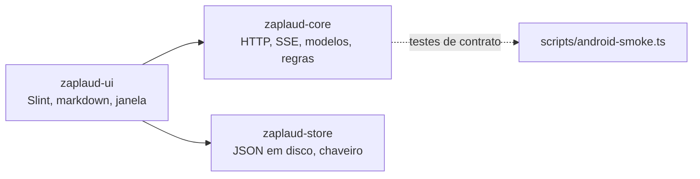

# Plano 074: cliente desktop do Zaplaud em Rust + Slint (roteiro por fases)

> **Instruções ao executor**: este plano tem fases independentes, cada uma com seu portão. Execute **uma fase por
> vez**, na ordem, e só comece a próxima depois que a anterior passar no portão e o dono aprovar. Em condição de
> PARADA, pare e relate. Ao terminar uma fase, atualize a linha 074 em `plans/README.md` com a fase concluída.
>
> **Verificação de desvio (primeiro, em cada fase)**:
> `git diff --stat e214452..HEAD -- android/shared/src/commonMain android/shared/src/jvmMain server/http scripts/android-smoke.ts server/test/android-fixture.ts`.
> Se o Zaplaud Kotlin ganhou recurso novo desde `e214452`, acrescente-o à tabela de paridade antes de seguir.

## Status

- **Prioridade**: P3
- **Esforço**: L (vários L; ver fases)
- **Risco**: HIGH (duplica a interface; só compensa se o consumo da JVM incomodar no uso real)
- **Depende de**: decisão do dono. O portão do plano 067 abriu por memória (339 MiB > 300 MiB, medido com servidor de
  teste), e a recomendação foi **não reescrever agora**. Em 2026-11-10 o dono mandou executar, depois de medir
  418–490 MiB no miranote. **Resultado das fases 0–5: [074-resultado.md](074-resultado.md).** Falta a fase 6.
- **Categoria**: direction
- **Planejado em**: commit `e214452` (merge do desktop em `producao`), 2026-11-09

## Por que importa

O dono pediu um cliente desktop "leve, tipo Rust ou Go". O Zaplaud desktop atual (Compose/JVM, planos 063–066) tem
paridade total com o celular, mas usa 339 MiB de PSS parado, abre em ~1 s e ocupa 192 MiB instalado. O spike do
plano 067 mostrou que Rust + Slint resolve as três dúvidas técnicas com 22 MiB de PSS, abertura em 114 ms e binário
de 17 MiB. Os números completos estão em `plans/067-resultado.md`. O custo é refazer 27 capacidades e manter duas
interfaces de desktop até o Compose desktop ser removido. Este plano diz o que fazer, em que ordem e como saber que
acabou.

## O que já se sabe (spike do 067, `/tmp/zaplaud-rust-spike`, temporário)

- Versões que funcionaram: Rust 1.96.1; `slint 1.18.1` (features `std`, `backend-winit-x11`, `renderer-software`,
  `compat-1-2`); `pulldown-cmark 0.13.6`; `reqwest 0.12.28`; `serde_json 1.0.154`. Release com `strip = true` e
  `lto = "thin"`.
- **Markdown**: componentes Slint próprios alimentados por `pulldown-cmark` mostram título, listas, código e tabela.
  Seleção e cópia funcionam **dentro de cada bloco ou célula** (cada um é um `TextInput` somente leitura). Não
  funcionam: seleção atravessando blocos, tabela com N colunas, rolagem horizontal de código, negrito e itálico no
  meio do parágrafo, listas ordenadas e aninhadas, links e citações.
- **Acentos pt-BR**: teclas mortas (`´`+`a`, `~`+`a`, AltGr+`,`) funcionaram no X11 com layout `us(intl)`. Wayland e
  macOS não foram testados.
- **Protocolo**: `POST /api/remote/login` com JSON `{user, password}` devolve o cookie `habblaud_remote`. Com ele,
  `GET /api/stream` (SSE) entrega eventos `snapshot`. Sessões principais: `kind=main`, sem `parentId`, com `account`
  e `sessionId`; título em `title`, senão `name`. O parser SSE precisa juntar os campos `data:` até a linha vazia
  (um chunk HTTP não é um evento).
- O binário precisa de `libxkbcommon-x11.so` no Linux.

## Fonte de verdade que o cliente Rust deve seguir

| O quê | Onde (Kotlin, em `android/shared/src/commonMain/kotlin/br/com/xlinx/habblaud/`) |
|---|---|
| Rotas HTTP/SSE (~25) e cookie | `data/HabblaudApi.kt`, `data/SessionRepository.kt`, `data/ConversationRepository.kt`, `data/MessageController.kt`, `data/AsideController.kt`, `CastActions.kt`, `PermissionSheet.kt`, `SettingsScreen.kt` |
| Regras de lista (abertas/recentes, não lidas, ordem, subagentes) | `ReadingScreen.kt` (`byLastMessage`, `mergeSessions`), `data/ReadingController.kt` |
| Regras da conversa (agrupamento, filtros de vista, erros recuperados) | `ReadingScreen.kt`: `groupTurn`, `visibleEntries`, `recoveredErrors`, `entryTime` |
| Avisos | `data/NotificationRules.kt` (`agentEvents`, `watchOf`), `data/AlertWatcher.kt` |
| Tema (cores claro/escuro) | `ZaplaudApp.kt:39-59` |
| Textos (pt-BR) | `composeResources/values/strings.xml` |
| Ícones | `composeResources/drawable/*.xml` (vetores Android; `pathData` é caminho SVG) |
| Layout desktop | `docs/zaplaud-desktop.md`, seção "Duas colunas" (360 dp de lista, corte em 840 dp, conversa até 840 dp) |
| Servidor de teste | `scripts/android-smoke.ts` (`--port`, `--allow terminal,messages,permissions`; usuário e senha `android-test`; comandos no stdin como `permission <agentId> bash`, `deliver <agentId>`) |

**Regra de harmonia**: cores, textos e ícones **não** são copiados à mão. O `build.rs` do crate de interface lê
`strings.xml`, as cores de `ZaplaudApp.kt` (ou um `theme.json` extraído por script e versionado ao lado) e converte os
vetores em SVG. Assim, mudar o tema ou um texto no Kotlin muda os dois clientes.

## Arquitetura proposta

- Workspace Cargo em `zaplaud-rs/` na raiz do repositório, ao lado de `android/` e `ios/`.
- `zaplaud-core`: sem interface; `tokio`, `reqwest` (rustls), `serde`. Porta as regras puras com os mesmos nomes do
  Kotlin, para facilitar a comparação.
- `zaplaud-store`: mesmo formato em disco do store iOS/JVM (`android/shared/src/jvmMain/.../LocalStateStore.jvm.kt`)
  e nas mesmas pastas (`~/.local/share/zaplaud`, `~/Library/Application Support/Zaplaud`), para poder trocar de
  cliente sem perder rascunhos. Cookie no chaveiro (crate `keyring`); sem chaveiro, só memória, como no JVM.
- `zaplaud-ui`: Slint + `pulldown-cmark`; arquivos com `rfd`; avisos com `notify-rust`; pastas com `directories`.
- Testes de contrato: `cargo test -p zaplaud-core` sobe `scripts/android-smoke.ts`, como fazem
  `TwoPaneWideUiTest`/`TwoPaneNarrowUiTest` no Kotlin.

Considerado e descartado por ora: núcleo Rust compartilhado com Kotlin via UniFFI. Evitaria duplicar regras, mas não
a interface, e acrescentaria uma ponte nativa ao Android e ao iOS sem ganho para o celular.

## Tabela de paridade (27 capacidades; tamanhos do 067)

| # | Capacidade | Tam. | Fase |
|---|---|---|---|
| 1 | Login com aviso de HTTP | S | 1 |
| 2 | Vários servidores (login e saída por servidor, lista única) | M | 1 |
| 3 | Contrato HTTP/SSE das ~25 rotas, reconexão e estados de erro | L | 1 |
| 4 | Abertas / Recentes | M | 1 |
| 5 | Não lidas | M | 1 |
| 6 | Subagentes pendurados no principal | M | 1 |
| 7 | Busca (oculta; Ctrl+F) | S | 1 |
| 8 | Filtro por servidor | S | 1 |
| 9 | Avatares e cache | M | 1 |
| 10 | Markdown fiel com seleção e rolagem | L | 2 |
| 11 | Pensamentos compactos | M | 2 |
| 12 | Ferramentas compactas | M | 2 |
| 13 | Ir para o fim / contador de novas | M | 2 |
| 14 | Resumo de respostas | S | 2 |
| 15 | Rascunho persistente por sessão | M | 3 |
| 16 | Anexos (seletor, upload em stream, limites) | L | 3 |
| 17 | Modos de envio (acrescentar, enfileirar, mudar direção) | M | 3 |
| 18 | Interrupção (stop) com confirmação | M | 3 |
| 19 | Anel de contexto | S | 3 |
| 20 | Shake | S | 3 |
| 21 | Aprovação / pergunta (`/api/permissions`) | L | 3 |
| 22 | Elenco: chamar, dispensar, retomar com Novo | L | 4 |
| 23 | Bate-papo paralelo (`/api/asides`) | L | 4 |
| 24 | Configurações | M | 4 |
| 25 | Papéis (modelo, raciocínio) | M | 4 |
| 26 | Regras de aviso + entrega (notificação) | M | 5 |
| 27 | Duas colunas, Esc, Enter envia (layout desktop) | — (faz parte da fase 1/2) | 1–2 |

## Fases

Cada fase termina com: `cargo build --release`, `cargo test --workspace` (com o servidor de teste), `cargo clippy -- -D warnings`
e capturas no Xvfb das telas da fase, ao lado das mesmas telas do Compose desktop.

### Fase 0: esqueleto e decisão de manutenção (S)

- Workspace `zaplaud-rs/` com os três crates; `build.rs` gerando textos, cores e ícones a partir do Kotlin.
- Job novo no CI (`.github/workflows/android.yml` ou `rust.yml`) com `cargo test` + `xvfb-run`.
- **Decisão do dono, registrada no README do plano**: depois da fase 6, o Compose desktop sai (`android/desktop` e
  `android/shared/src/jvmMain`) ou fica? Manter os dois é a pior opção.
- **Portão**: `cargo build` e `cargo test` verdes; textos gerados batem com `strings.xml` (teste que conta as chaves).

### Fase 1: login, servidores e lista ao vivo (L)

Capacidades 1–9 e o layout de duas colunas (lista à esquerda; direita com "Selecione uma conversa").
- **Portão**: teste de contrato loga, recebe `snapshot`, aplica `permission <agentId> bash` e vê a mudança; não lidas e
  ordem iguais às do Kotlin para o mesmo snapshot (gere um snapshot fixo e compare com `byLastMessage` via teste
  JVM que grava o resultado esperado em JSON).

### Fase 2: conversa e markdown (L, maior risco)

Capacidades 10–14. O renderizador precisa de: N colunas em tabela, rolagem horizontal de código, estilos inline,
listas ordenadas e aninhadas, links clicáveis, citação, e seleção que atravesse blocos **ou** um "copiar mensagem"
explícito se a seleção cruzada não for viável em Slint.
- **Portão**: as 16 mensagens de código e as tabelas da sessão `fixture:claude` aparecem como no Compose (comparação
  lado a lado de capturas); copiar uma mensagem inteira cola o markdown original.
- **PARADA**: se a seleção ou o texto rico exigirem reescrever o motor de texto do Slint, pare e relate. É o ponto
  de desistir com menor custo.

### Fase 3: escrever e controlar (L)

Capacidades 15–21. Rascunho no mesmo arquivo do store JVM/iOS; anexos com streaming (sem carregar o arquivo inteiro
na memória; limites de `data/Attachments.kt`: 15 MiB, 5 arquivos); aprovação com as mesmas opções do `PermissionSheet.kt`.
- **Portão**: envio entregue (`deliver <agentId>` no stdin do servidor de teste e o aviso de estado some); anexo de
  31 bytes chega idêntico ao `deliveredDir`; aprovação aceita e recusada pelo servidor de teste.

### Fase 4: elenco, bate-papo paralelo e configurações (L)

Capacidades 22–25.
- **Portão**: chamar, dispensar e retomar com Novo funcionam contra o servidor de teste; pergunta paralela enviada e
  cancelada; troca de tema muda as cores geradas.

### Fase 5: sistema (M)

Capacidade 26, chaveiro, pacotes (`cargo-deb`, `cargo-generate-rpm`; `.app`/`.dmg` com `cargo-packager` ou
`cargo-bundle` num Mac), ícone, item de menu.
- **Portão**: aviso real num GNOME ou KDE com "Abrir"; login sobrevive a fechar e abrir com chaveiro; `.deb`
  instalado num Debian/Ubuntu e `.dmg` aberto num Mac.

### Fase 6: paridade e troca (M)

- Repetir a medição do 067 (mesmo método e servidor de teste) com o cliente Rust completo. Ele precisa ficar **abaixo de
  100 MiB de PSS parado e de 300 ms de abertura**; senão, o ganho não paga a duplicação.
- Uma semana de uso real do dono com o cliente Rust.
- Executar a decisão da fase 0 (remover o Compose desktop num corte limpo, atualizando `docs/zaplaud-desktop.md`,
  READMEs, CI e `CHANGELOG.md`).

## Regras de manutenção enquanto existirem dois clientes desktop

- Toda mudança de comportamento no Zaplaud Kotlin que afete lista, conversa, compositor, aprovação, elenco ou avisos
  precisa de uma linha na tabela de paridade acima ("Kotlin mudou em `<commit>`; Rust pendente/feito").
- Nada de cor, texto ou ícone escrito à mão no Rust: sempre gerado do Kotlin.
- Os testes de contrato usam o mesmo `scripts/android-smoke.ts` que o Android e o JVM; mudou o servidor, rodam os três.

## Critérios de pronto (do plano inteiro)

- [ ] As 27 linhas da tabela de paridade marcadas como feitas, cada uma com teste ou captura.
- [ ] `cargo test --workspace` e o job de CI verdes.
- [ ] Medição da fase 6 abaixo dos limites, registrada em `plans/074-resultado.md`.
- [ ] Decisão da fase 0 executada; `docs/zaplaud-desktop.md` descreve só o cliente que ficou.

## Condições de PARADA

- Fase 2 sem caminho viável para texto rico e cópia (ver acima).
- Teclas mortas ou IME falham no Wayland ou no macOS sem correção no Slint estável.
- Acessibilidade: o leitor de tela (Orca/VoiceOver) não lê lista e mensagens. Slint expõe acessibilidade, mas a
  cobertura para este app não foi testada.
- O dono decide manter só o Compose desktop: marque 074 como REJECTED com o motivo.

## Notas de manutenção

- O spike vive em `/tmp/zaplaud-rust-spike` e some em até 10 dias; o que importa dele está neste plano e em
  `plans/067-resultado.md`.
- Se o Compose Multiplatform reduzir o consumo nativo em versões futuras, refaça a medição do 067 antes de começar.
